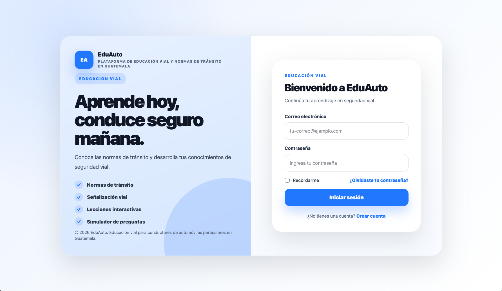

# EduAuto: plataforma web para el aprendizaje teórico de la conducción en Guatemala

## Descripción

EduAuto es una plataforma web con enfoque UX/UI para el aprendizaje teórico de la conducción de automóviles particulares (licencia tipo C) en Guatemala. El contenido se basa en la Ley y el Reglamento de Tránsito vigentes, la cartilla de infracciones y el Manual de Educación Vial.

Hoy esa información está repartida en varios documentos oficiales que no están pensados para estudiar. La plataforma la organiza en cursos, módulos y lecciones con texto, video y recursos de apoyo, y agrega un simulador de preguntas con retroalimentación para practicar antes del examen teórico.

La versión publicada en [eduauto.net](https://eduauto.net) tiene 1 curso, 5 módulos, 10 lecciones y 31 preguntas:

1. Licencia tipo C, obligaciones y responsabilidad del conductor
2. El tránsito y sus usuarios
3. La vía pública
4. Señalización vial
5. Conducción segura y reglas viales

En la evaluación con 22 participantes la plataforma obtuvo 83.52 puntos en la escala SUS, y el promedio de accesibilidad en Google Lighthouse fue de 94.62 sobre 100 en 26 pantallas evaluadas. El detalle está en el informe final.

La plataforma maneja tres roles:

- **Estudiante:** estudia los módulos y lecciones, marca lecciones como completadas, consulta su progreso, guarda favoritos, busca contenido y practica con el simulador (resultado, respuestas correctas e historial de intentos).
- **Gestor de contenido:** crea y edita cursos, módulos, lecciones, recursos y preguntas, y revisa el contenido antes de publicarlo.
- **Administrador:** tiene lo mismo que el gestor y además administra usuarios y roles y configura los textos del sitio (CMS).

## Tecnologías Utilizadas

| Tecnología | Versión | Uso |
|---|---|---|
| PHP | 8.4 | Backend |
| Laravel | 13.23 | Framework principal (MVC) |
| Blade | incluido en Laravel | Plantillas de las vistas |
| Livewire | 4.3 | Componentes interactivos |
| PostgreSQL | 17 | Base de datos |
| Tailwind CSS | 4.3 | Estilos de la interfaz |
| Vite | 8.2 | Compilación de CSS y JavaScript |
| Laravel Vite Plugin | 3.1 | Integración de Vite con Laravel |
| Composer | 2 | Dependencias de PHP |
| Node.js y npm | 22 y 10 | Dependencias y compilación del frontend |
| Git y GitHub | 2.x | Control de versiones |
| Microsoft Clarity | — | Analítica de uso durante las pruebas (opcional) |

Para producción se usaron además Ubuntu Server 24.04 LTS, Nginx 1.24 con PHP-FPM 8.4, Let's Encrypt con Certbot para HTTPS, Cloudflare para el DNS y un Droplet de DigitalOcean.

## Requisitos Previos

- PHP 8.3 o superior (se probó con 8.4), con las extensiones `pdo_pgsql`, `pgsql`, `mbstring`, `openssl`, `xml`, `curl`, `zip`, `fileinfo` y `gd`
- Composer 2
- Node.js 22.12 o superior y npm 10 (Vite 8 no funciona con Node.js 18)
- PostgreSQL 17 (también funciona con 14 o superior)
- Git
- Equipo recomendado para desarrollo: 2 núcleos, 4 GB de RAM y 10 GB libres. Funciona en macOS, Windows o Linux.

## Instalación

1. Clonar el repositorio:

   ```bash
   git clone https://github.com/GraduacionesUVG/2026-22992-reyes-morales-brandon-javier.git
   cd 2026-22992-reyes-morales-brandon-javier/src
   ```

2. Instalar dependencias de PHP y de JavaScript:

   ```bash
   composer install
   npm ci
   ```

3. Configurar las variables de entorno:

   ```bash
   cp .env.example .env
   php artisan key:generate
   ```

   Editar `.env` y completar `DB_PORT`, `DB_DATABASE`, `DB_USERNAME` y `DB_PASSWORD` con los datos de tu PostgreSQL local (el puerto por defecto es 5432).

4. Crear el usuario y la base de datos en PostgreSQL (con los mismos nombres que pusiste en `.env`):

   ```bash
   psql postgres
   ```

   ```sql
   CREATE USER usuario_de_base_de_datos WITH PASSWORD 'contrasena_de_base_de_datos';
   CREATE DATABASE nombre_de_base_de_datos OWNER usuario_de_base_de_datos;
   \q
   ```

5. Ejecutar las migraciones y cargar los datos iniciales. El seeder crea los usuarios de prueba y un curso base con 2 módulos y 4 lecciones; el resto del contenido se carga desde el panel del gestor de contenido.

   ```bash
   php artisan migrate --seed
   ```

6. Crear el enlace público para los recursos de las lecciones (videos e imágenes):

   ```bash
   php artisan storage:link
   ```

## Ejecución

Compilar los recursos del frontend y levantar el servidor:

```bash
npm run build
php artisan serve
```

La plataforma queda disponible en `http://localhost:8000`.

Para desarrollo, con recarga automática de estilos y scripts, se usan dos terminales:

```bash
php artisan serve
```

```bash
npm run dev
```

### Despliegue en producción

La plataforma está publicada en [https://eduauto.net](https://eduauto.net) con esta configuración:

| Recurso | Configuración |
|---|---|
| Servidor | Droplet de DigitalOcean: 1 vCPU, 1 GB de RAM, 33 GB de disco y 2 GB de swap |
| Sistema operativo | Ubuntu Server 24.04 LTS |
| Servidor web | Nginx 1.24 + PHP-FPM 8.4 |
| Base de datos | PostgreSQL 17, solo accesible desde el propio servidor |
| Dominio y HTTPS | DNS en Cloudflare, certificado de Let's Encrypt con renovación automática (Certbot) |

Pasos generales para una instalación nueva:

1. Crear un Droplet con Ubuntu 24.04 LTS y acceso por llave SSH.
2. Instalar Nginx, PHP 8.4 con PHP-FPM y las extensiones de la lista de requisitos, PostgreSQL 17, Composer y Git.
3. Clonar el repositorio en `/var/www/` y, dentro de la carpeta del proyecto, ejecutar `composer install --no-dev --optimize-autoloader`.
4. Crear la base de datos y el `.env` de producción a partir de `.env.example`, con `APP_ENV=production`, `APP_DEBUG=false`, `APP_URL=https://tu-dominio` y `SESSION_SECURE_COOKIE=true`.
5. Ejecutar `php artisan key:generate`, `php artisan migrate --force`, `php artisan storage:link`, `php artisan config:cache` y `php artisan view:cache`.
6. Configurar Nginx con la raíz del sitio en la carpeta `public/` del proyecto y dar permisos de escritura a `storage/` y `bootstrap/cache/`.
7. Apuntar el dominio a la IP del servidor (registro A) y emitir el certificado con `sudo certbot --nginx -d tu-dominio`.

El servidor de 1 GB no compila el frontend: `npm run build` se ejecuta en la computadora de desarrollo y la carpeta `public/build` se copia al servidor.

### Usuarios de prueba

El seeder (`src/database/seeders/DatabaseSeeder.php`) crea una cuenta por rol: `admin@ejemplo.com`, `gestor@ejemplo.com` y `estudiante@ejemplo.com`. Las contraseñas de prueba están definidas en ese mismo archivo. Son solo para uso local.

En una instalación nueva el sitio aparece con el nombre por defecto "AutoEscuela Virtual". El nombre, el logo, los colores y los textos del login se cambian desde el administrador, en **Configuración CMS**.

## Estructura del repositorio

```
/capturas   Capturas de pantalla del sistema
/demo       Video demostrativo (demo.mp4)
/docs       Informe final y consentimiento firmado
/src        Código fuente (proyecto Laravel)
  /Material Videos finales de las lecciones y documento con el contenido cargado
README.md
```

## Capturas

Las capturas de pantalla del sistema se encuentran en [`/capturas`](capturas/).

| # | Pantalla |
|---|----------|
| [01](capturas/captura-01.jpg) | Inicio de sesión |
| [02](capturas/captura-02.png) | Panel del administrador con el resumen de usuarios, contenido y simulador |
| [03](capturas/captura-03.png) | Gestión de cursos |
| [04](capturas/captura-04.png) | Listado de los 5 módulos del curso |
| [05](capturas/captura-05.png) | Edición de un módulo |
| [06](capturas/captura-06.png) | Lecciones de un módulo |
| [07](capturas/captura-07.png) | Edición de una lección con el editor de contenido |
| [08](capturas/captura-08.png) | Banco de preguntas por módulo |
| [09](capturas/captura-09.png) | Edición de una pregunta, sus opciones y la respuesta correcta |
| [10](capturas/captura-10.png) | Revisión de contenido publicado y en borrador |
| [11](capturas/captura-11.png) | Gestión de usuarios y roles |
| [12](capturas/captura-12.png) | Configuración CMS: nombre, logo, colores y textos |
| [13](capturas/captura-13.png) | Perfil del usuario |
| [14](capturas/captura-14.png) | Panel principal del estudiante con su progreso y accesos rápidos |
| [15](capturas/captura-15.png) | Módulos del curso vistos por el estudiante |
| [16](capturas/captura-16.png) | Lección con sus fuentes legales, botón para marcarla como completada y video de apoyo |
| [17](capturas/captura-17.png) | Simulador de preguntas de un módulo |
| [18](capturas/captura-18.png) | Resultado del simulador con respuestas correctas y retroalimentación |
| [19](capturas/captura-19.png) | Panel del gestor de contenido |
| [20](capturas/captura-20.png) | Gestión de módulos desde el rol de gestor |



## Demo

El video demostrativo se encuentra en [`/demo/demo.mp4`](demo/demo.mp4).

## Documentación

El informe final del proyecto está disponible en [`/docs/informe_final.pdf`](docs/informe_final.pdf).

El consentimiento de uso de foto y video firmado se encuentra en [`/docs/consentimiento_firmado.pdf`](docs/consentimiento_firmado.pdf).

## Material de las lecciones

En [`/src/Material`](src/Material/) están los recursos que se cargaron en la plataforma:

- [`EduAuto_contenido_y_configuracion.docx`](src/Material/EduAuto_contenido_y_configuracion.docx): el texto de los 5 módulos, las 10 lecciones y las 31 preguntas, además de la configuración del CMS.
- [`/lecciones`](src/Material/lecciones/): los videos finales de cada lección, editados en DaVinci Resolve.

| Módulo | Lección | Videos |
|---|---|---|
| 1. Licencia tipo C, obligaciones y responsabilidad del conductor | 1.1 Qué autoriza la licencia tipo C y requisitos del conductor | [leccion_1_1](src/Material/lecciones/leccion_1_1/) |
| | 1.2 Obligaciones, prohibiciones y actuación ante emergencias | [leccion_1_2](src/Material/lecciones/leccion_1_2/) |
| 2. El tránsito y sus usuarios | 2.1 El tránsito como sistema y sus elementos | [leccion_2_1](src/Material/lecciones/leccion_2_1/) |
| | 2.2 Peatones, zonas escolares y seguridad de pasajeros | [leccion_2_2](src/Material/lecciones/leccion_2_2/) |
| 3. La vía pública | 3.1 Qué es la vía pública y cuáles son sus partes | [leccion_3_1](src/Material/lecciones/leccion_3_1/) |
| 4. Señalización vial | 4.1 Prioridad entre señales y tipos de señalización | [leccion_4_1](src/Material/lecciones/leccion_4_1/) |
| | 4.2 Señales verticales: reglamentarias, preventivas e informativas | [leccion_4_2](src/Material/lecciones/leccion_4_2/) |
| | 4.3 Señalización horizontal y semáforos | [leccion_4_3](src/Material/lecciones/leccion_4_3/) |
| 5. Conducción segura y reglas viales | 5.1 Preparación, maniobras y obligación de advertir | [leccion_5_1](src/Material/lecciones/leccion_5_1/) |
| | 5.2 Rebase, incorporación, cambio de carril y puntos ciegos | [leccion_5_2](src/Material/lecciones/leccion_5_2/) |

Estos archivos son una copia de referencia. Para que aparezcan en la plataforma se suben desde el panel del gestor, en la edición de cada lección.

## Autores

- Brandon Javier Reyes Morales - 22992

## Licencia

MIT
